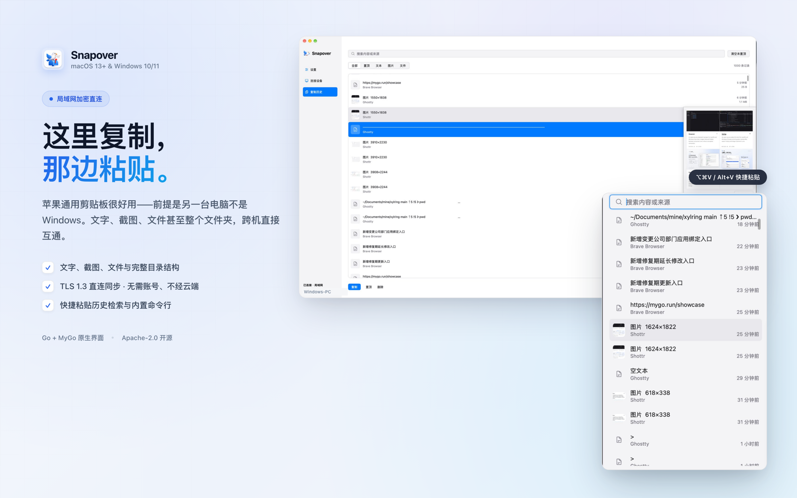

<p align="center">
  
</p>

<h1 align="center">Snapover</h1>

<p align="center">
  <strong>这里复制，那边粘贴。</strong><br><br>
  苹果通用剪贴板很好用——前提是你的另一台电脑不是 Windows。<br>
  Snapover 让桌上的 Mac 和 Windows 共用同一块剪贴板：左边 <code>⌘C</code>，右边 <code>Ctrl+V</code>。<br>
  文字、截图、文件甚至整个文件夹，局域网加密直连秒达。<br>
  <strong>不用账号，不经云端，不套壳浏览器。</strong>
</p>

<p align="center">
  <a href="https://github.com/2fa0/snapover/releases"><strong>⬇ 下载 Snapover</strong></a> •
  <a href="#-典型日常">典型日常</a> •
  <a href="#-核心亮点">核心亮点</a> •
  <a href="#-快速开始">快速开始</a> •
  <a href="#-命令行工具">命令行</a> •
  <a href="#-从源码构建">源码构建</a>
</p>

<p align="center">
  <a href="https://github.com/2fa0/snapover/releases"></a>
  
  
  
  
</p>

<p align="center">
  <strong>简体中文</strong> | <a href="README_en.md">English</a>
</p>

<p align="center">
  
</p>

---

<p align="center">
  <strong>文字 · 图片 · 文件 · 文件夹</strong><br>
  不用打开聊天软件给自己发文件，不用找 U 盘，也不用弹窗选设备。复制，然后粘贴。
</p>

## ⚡ 典型日常

两台电脑摆在同一个桌面，最烦的从来不是“传不动”，而是**思路被强行打断**：

- **在 Mac 上选好几个文件或整个文件夹 `⌘C`** → 转头在 Windows 资源管理器里直接 `Ctrl+V`，目录结构原样落地，不用打包压缩。
- **在 Windows 上刚截完一张图** → 切回 Mac 文档直接 `⌘V` 贴进去，不用再保存、传文件、翻下载目录。
- **在终端里顺手把报错送过去** → `cat error.log | snapover send text --stdin`，另一台电脑直接就能粘贴。

## ✨ 核心亮点

<table>
  <tr>
    <td width="50%" valign="top">
      <h3>📁 连文件夹都能直接 <code>⌘C</code> / <code>Ctrl+V</code></h3>
      代码片段、截图、文件甚至整个文件夹，在 Finder 或资源管理器里直接选中复制，切到另一台电脑直接粘贴，完整保留目录结构——不用打 zip，也不用弹出发送窗口。
    </td>
    <td width="50%" valign="top">
      <h3>⚡ 也是顺手的本机剪贴板历史</h3>
      macOS 按 <code>⌥⌘V</code>、Windows 按 <code>Alt+V</code> 秒出历史面板，支持全文检索，回车直接贴进当前应用。常用条目可以置顶，前九项还能用数字快捷键一键速贴。
    </td>
  </tr>
  <tr>
    <td width="50%" valign="top">
      <h3>📦 大文件直传，断了也能接着传</h3>
      通过 Finder「服务」、Windows「发送到」或命令行，把文件直接存进对端接收目录。支持暂停、续传和断线重连，不设应用层文件大小上限。
    </td>
    <td width="50%" valign="top">
      <h3>🔒 你的剪贴板，不经任何服务器</h3>
      设备之间 TLS 1.3 直连。首次配对时两端核对六位码并确认，之后按保存的证书指纹校验。没有账号、云端存储和遥测，离线局域网也能用。
    </td>
  </tr>
  <tr>
    <td width="50%" valign="top">
      <h3>🛡️ 敏感密码自动避让，规则随你定</h3>
      密码管理器标记过的敏感内容既不写入历史，也不会被发送。支持自动或手动同步、随时暂停、只同步文字、排除指定应用，或只忽略下一次复制。
    </td>
    <td width="50%" valign="top">
      <h3>🪶 Go 原生界面，还能塞进脚本</h3>
      使用 Go + MyGo 绘制原生控件，告别浏览器套壳的笨重感。内置的 <code>snapover-cli</code> 可以把文字、图片和文件直接接入终端与自动化工作流。
    </td>
  </tr>
</table>

**还有这些：**Mac 配 Windows、两台 Mac 或两台 Windows 都能配对；支持自定义快捷键、图片预览与缩放、自动更新、中英文界面，以及可选的 Tailscale 跨网络连接。

> [!NOTE]
> 通过剪贴板复制文件／文件夹时，整批默认上限为 20 MB，可在设置中调整；**主动发送文件不受此限制**。完整限制与边界见[功能与行为细节](docs/features_zh.md)。

<details>
<summary><strong>🤔 和 Maccy / Ditto / LocalSend 有什么区别？</strong></summary>

<br>

Snapover 和这几个优秀的开源工具各有侧重，只想要其中一样时用对应工具就够轻巧：

| 你的主要需求 | 更合适的选择 |
| :--- | :--- |
| 只在一台 Mac 上管理复制历史 | [Maccy](https://maccy.app) |
| 只在一台 Windows 上管理复制历史 | [Ditto](https://ditto-cp.sourceforge.io) |
| 偶尔在设备之间发文件 | [LocalSend](https://localsend.org) |
| **两台电脑摆在同一个桌面，文字、截图、文件、历史、终端高频来回走** | **Snapover** |

</details>

## 🚀 快速开始

### 1. 在两台电脑上安装 Snapover

从 [**Releases**](https://github.com/2fa0/snapover/releases) 下载最新安装包：

- **macOS 13+**：Apple Silicon 选择 `snapover-<版本>-arm64.dmg`，Intel 选择 `snapover-<版本>-amd64.dmg`，打开后把 Snapover 拖进「应用程序」。
- **Windows 10/11 x64**：解压 `Snapover-<版本>-windows-x64.zip`，保留同目录文件并运行 `Snapover.exe`。在 exe 旁放一个空的 `portable.flag`，数据就会保存到同目录的 `data/` 文件夹。

<details>
<summary><strong>遇到系统安全拦截或发现不了设备？点此查看放行说明</strong></summary>

<br>

- **macOS：**目前使用 ad-hoc 签名，尚未公证。右键 `Snapover.app` 选择「打开」，或执行 `xattr -cr /Applications/Snapover.app`。没有 Developer ID 时，安装包只能在打包那台 Mac 上直接打开。系统请求「本地网络」权限时请允许。
- **Windows：**尚未进行代码签名，SmartScreen 可能需要选择「更多信息 → 仍要运行」。防火墙需放行入站 TCP `47821`，自动发现还需要 UDP `5353`；配对前可在「连接设备」页一键添加防火墙规则。

</details>

### 2. 配对一次

1. 在两台电脑上打开「连接设备 → 添加设备」。
2. 选择另一台电脑；发现不到时手动填写地址，默认端口为 `47821`。
3. 核对两边显示相同的**六位配对码**，然后在**两台电脑上分别确认**。

Snapover 会记住已配对设备并自动重连。双方确认前不会同步任何内容。

### 3. 复制，切到另一台，粘贴

日常用法就只有这一步。Snapover 常驻菜单栏或系统托盘，关闭窗口不会停止同步。

手动同步、网段选择、多设备与连接排查见[功能与行为细节](docs/features_zh.md)。

## ⌘ 常用快捷键

| 操作 | macOS | Windows |
| --- | --- | --- |
| 唤出复制历史 | `⌥⌘V` 或 `Cmd+Shift+V` | `Alt+V` |
| 手动模式下复制并同步 | `⌥⌘C` | `Ctrl+Alt+C` |
| 粘贴前九个置顶条目 | `⌘1`–`⌘9` | `Ctrl+1`–`Ctrl+9` |
| 只写入剪贴板，不直接粘贴 | `⌥Enter` | `Alt+Enter` |
| 置顶／取消置顶选中条目 | `⌘⇧P` | `Ctrl+Shift+P` |
| 删除选中条目 | `⌘⇧⌫` | `Ctrl+Shift+Backspace` |

所有快捷键都能在设置里改。macOS 的快捷粘贴需要在「系统设置 → 隐私与安全性 → 辅助功能」中授权。

## 💻 命令行工具

安装包里的 `snapover-cli` 复用桌面应用已经建立的配对和连接，不用二次配置，也不弹发送窗口。把它加入 `PATH`（或设别名为 `snapover`），然后运行：

```sh
snapover send file './报告.pdf' './截图.png'
snapover send text '你好'
snapover send image './截图.jpg'
cat ./notes.txt | snapover send text --stdin
```

文件进入对端的接收目录，文字和图片写进对端剪贴板。当前没有在线设备时命令会立即报错，不会排队等待。

macOS 与 Windows 的配置方法、PowerShell 示例、完整参数和退出码见[命令行指南](docs/cli_zh.md)。

## 🔧 从源码构建

需要 **Go 1.27.3+**（以 `go.mod` 为准），不需要 cgo。

```sh
git clone https://github.com/2fa0/snapover.git
cd snapover
go test ./...
go run ./cmd/snapover
```

源码直接运行不能自动更新；Finder「服务」等系统集成需要打包后的应用。打包与发布步骤见[构建与发布](docs/build_zh.md)。

## 🚧 已知限制

- **远程桌面：**Windows RDP 会话请关闭剪贴板共享，否则 `rdpclip.exe` 可能在 Snapover 接收成功后覆盖内容。
- **图片：**以 PNG 传输，透明通道得以保留；Windows 上另提供一份 24 位位图给只认该格式的应用，在这些应用里粘贴会丢掉透明区域。细节见[图片格式说明](docs/features_zh.md#图片)。
- **暂未内置：**公网发现／中继和富文本同步。跨网络使用时，请让两台电脑接入 Tailscale，再在 Snapover 中开启支持。

当前行为、完整限制与故障排查见[功能与行为细节](docs/features_zh.md)。

## 🔐 隐私与安全

- 剪贴板数据、配对记录和复制历史都保存在自己的电脑上：macOS 为 `~/Library/Application Support/Snapover`，Windows 为 `%AppData%\Snapover`。
- 没有遥测，不自动上传日志；日志不记录剪贴板正文、图片字节或私钥。
- 安全漏洞请参照 [SECURITY.md](SECURITY.md) 私下反馈，不要在公开场合披露细节。

## 🙏 致谢

原生界面、打包与自动更新这几层来自 [MyGo](https://github.com/egoist/mygo)，感谢 egoist 与所有为它提交过改动的人。

## 📄 开源协议

Snapover 以 [Apache License 2.0](LICENSE) 授权，版权归作者所有（© 2026 2fa0）。你可以自由使用、修改和分发，包括商业用途，条件是保留版权与许可声明、随分发附带许可证全文，并遵守其中的专利与商标条款。随包分发的第三方组件遵循各自许可证，完整清单见 [THIRD_PARTY_NOTICES.txt](resources/THIRD_PARTY_NOTICES.txt)。

<p align="center">
  遇到 Bug 或有工作流改进建议？欢迎 <a href="https://github.com/2fa0/snapover/issues">提交 Issue</a>。
</p>
