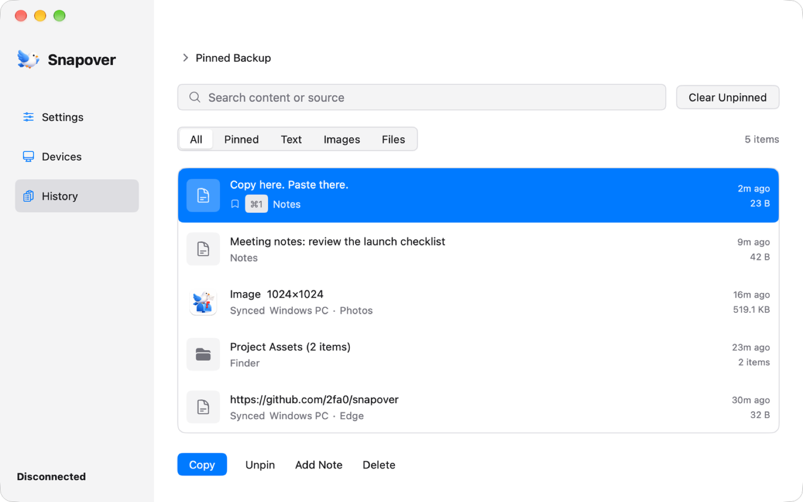

<p align="center">
  
</p>

<h1 align="center">Snapover</h1>

<p align="center">
  <strong>Copy here. Paste there.</strong><br><br>
  One shared clipboard for your Mac and Windows PC.<br>
  Move text, screenshots, files and entire folders between computers<br>
  over a direct, encrypted connection.<br>
  <strong>No account. No cloud. No embedded browser.</strong>
</p>

<p align="center">
  <a href="https://github.com/2fa0/snapover/releases"><strong>⬇ Download Snapover</strong></a> •
  <a href="#-who-its-for">Who it's for</a> •
  <a href="#-highlights">Highlights</a> •
  <a href="#-get-started">Get started</a> •
  <a href="#-command-line">CLI</a> •
  <a href="#-build-from-source">Build</a>
</p>

<p align="center">
  <a href="https://github.com/2fa0/snapover/releases"></a>
  
  
  
  
</p>

<p align="center">
  <strong>English</strong> | <a href="README_zh.md">简体中文</a>
</p>

<p align="center">
  
</p>

---

<p align="center">
  <strong>Text · Images · Files · Folders</strong><br>
  No upload button. No chat app. No USB drive. Just copy and paste.
</p>

## 🎯 Who it's for

Snapover overlaps with a few good, focused tools. If one of them is all you need, use it:

- **Clipboard history on one Mac** → [Maccy](https://maccy.app).
- **Clipboard history on one Windows PC** → [Ditto](https://ditto-cp.sourceforge.io).
- **Moving files between devices** → [LocalSend](https://localsend.org).
- **Two computers on the same desk, moving text, screenshots, files and folders both ways** → Snapover. Any pairing works: a Mac and a Windows PC, two Macs, or two Windows PCs.

## ✨ Highlights

<table>
  <tr>
    <td width="50%" valign="top">
      <h3>📋 Copy more than text</h3>
      Copy a code snippet, screenshot, file or whole folder on one computer and paste it on the other. Finder and Explorer selections work too, with directory structure preserved—no zipping or send dialog.
    </td>
    <td width="50%" valign="top">
      <h3>⚡ Find it. Paste it again.</h3>
      Press <code>⌥⌘V</code> on macOS or <code>Alt+V</code> on Windows to search your clipboard history. Hit Enter to paste into the app you were using. Pin frequent items and paste the first nine with a number shortcut.
    </td>
  </tr>
  <tr>
    <td width="50%" valign="top">
      <h3>📤 Send big files without the clipboard</h3>
      Use Finder Services, Windows “Send to”, or the CLI to save files directly into the other computer’s receiving folder. Pause, resume and reconnect interrupted transfers. No app-imposed file size limit.
    </td>
    <td width="50%" valign="top">
      <h3>🔒 Private by design</h3>
      Devices connect directly over TLS 1.3. First pairing uses a six-digit code confirmed on both computers; later connections verify the pinned certificate. No account, cloud storage or telemetry.
    </td>
  </tr>
  <tr>
    <td width="50%" valign="top">
      <h3>🎛️ You decide what syncs</h3>
      Choose automatic or manual sync, pause everything, sync text only, exclude selected apps, or ignore just the next copy. Content marked by a password manager is neither saved to history nor sent.
    </td>
    <td width="50%" valign="top">
      <h3>🪶 Native app. Terminal friendly.</h3>
      Built with Go and MyGo using native OS controls, which keeps the memory footprint lean. The bundled <code>snapover-cli</code> brings text, images and files into scripts and terminal workflows.
    </td>
  </tr>
</table>

**Also inside:** customizable shortcuts, full-text history search, image previews and zoom, automatic updates, English and Chinese interfaces, and optional Tailscale connectivity.

> [!NOTE]
> Clipboard file/folder batches are capped at 20 MB by default and can be adjusted. This limit does **not** apply to sending files directly. See [features and behaviour](docs/features.md) for all limits and edge cases.

## 🚀 Get started

### 1. Install Snapover on both computers

Download the latest package from [**Releases**](https://github.com/2fa0/snapover/releases):

- **macOS 13+**: choose `snapover-<version>-arm64.dmg` for Apple silicon or `snapover-<version>-amd64.dmg` for Intel, then drag Snapover into **Applications**.
- **Windows 10/11 x64**: extract `Snapover-<version>-windows-x64.zip` and run `Snapover.exe`, keeping the accompanying files together. Add an empty `portable.flag` beside it to store data in a local `data/` folder.

<details>
<summary><strong>First-launch notes: Gatekeeper, SmartScreen and firewall</strong></summary>

<br>

- **macOS:** builds are currently ad-hoc signed and not notarised. Right-click `Snapover.app` and choose **Open**, or run `xattr -cr /Applications/Snapover.app`. Without a Developer ID, a build opens directly only on the Mac that produced it. Allow **Local Network** access when macOS asks.
- **Windows:** builds are not code signed, so SmartScreen may require **More info → Run anyway**. Allow inbound TCP `47821`; automatic discovery also uses UDP `5353`. The **Connect devices** page can add the firewall rule before pairing.

</details>

### 2. Pair once

1. Open **Connect devices → Add device** on both computers.
2. Select the other computer, or enter its address manually if discovery cannot find it. The default port is `47821`.
3. Check that both screens show the same **six-digit code**, then confirm on **both** computers.

Snapover remembers the paired device and reconnects automatically. Nothing is synced before both sides confirm.

### 3. Copy. Switch computers. Paste.

That is the whole workflow. Snapover stays in the menu bar or system tray; closing its window does not stop synchronization.

For manual sync, network selection, multiple devices and connection troubleshooting, see [features and behaviour](docs/features.md).

## ⌘ Shortcuts

| Action | macOS | Windows |
| --- | --- | --- |
| Open quick history | `⌥⌘V` or `Cmd+Shift+V` | `Alt+V` |
| Copy and sync in manual mode | `⌥⌘C` | `Ctrl+Alt+C` |
| Paste one of the first nine pinned items | `⌘1`–`⌘9` | `Ctrl+1`–`Ctrl+9` |
| Write to the clipboard without pasting | `⌥Enter` | `Alt+Enter` |
| Pin or unpin the selected item | `⌘⇧P` | `Ctrl+Shift+P` |
| Delete the selected item | `⌘⇧⌫` | `Ctrl+Shift+Backspace` |

Every shortcut can be changed in Settings. Quick paste on macOS requires **System Settings → Privacy & Security → Accessibility** permission.

## 💻 Command line

The included `snapover-cli` reuses the desktop app’s existing pairing and connection—no second setup and no send window. Put it on your `PATH`, or alias it as `snapover`, then:

```sh
snapover send file './report.pdf' './screenshot.png'
snapover send text 'hello'
snapover send image './screenshot.jpg'
cat ./notes.txt | snapover send text --stdin
```

Files land in the other computer’s receiving folder; text and images go to its clipboard. With no online device, the command fails immediately instead of queueing.

See the [CLI guide](docs/cli.md) for macOS and Windows setup, PowerShell examples, options and exit codes.

## 🔧 Build from source

Requires **Go 1.27.3+** (see `go.mod`), with no cgo.

```sh
git clone https://github.com/2fa0/snapover.git
cd snapover
go test ./...
go run ./cmd/snapover
```

Source builds cannot self-update, and system integrations such as Finder Services require a packaged app. Packaging and release instructions are in [docs/build.md](docs/build.md).

## 🚧 Known limitations

- **Remote desktop:** disable clipboard sharing for Windows RDP sessions. `rdpclip.exe` can overwrite content after Snapover receives it.
- **Images:** transport uses PNG, which keeps transparency. Windows also publishes a 24-bit bitmap for applications that accept only that form, and those paste it flattened. See [image formats](docs/features.md#images) for the details.
- **Not built in:** internet discovery/relaying and rich-text sync. For separate networks, connect both computers with Tailscale and enable it in Snapover.

Current behaviour, limits and troubleshooting: [docs/features.md](docs/features.md).

## 🔐 Privacy and security

- Clipboard data, paired-device records and history stay on your computers: `~/Library/Application Support/Snapover` on macOS and `%AppData%\Snapover` on Windows.
- No telemetry or automatic log uploads. Logs do not contain clipboard text, image bytes or private keys.
- Report vulnerabilities privately as described in [SECURITY.md](SECURITY.md), rather than disclosing them in public.

## 🙏 Thanks

The native UI, packaging and auto-update plumbing come from [MyGo](https://github.com/egoist/mygo). Thanks to egoist and everyone who has contributed to it.

## 📄 License

Snapover is licensed under the [Apache License 2.0](LICENSE), copyright © 2026 2fa0. You may use, modify and distribute it, including commercially, provided you keep the copyright and license notices, ship the license text with every distribution, and follow its patent and trademark terms. Third-party components bundled with it keep their own licenses; see [THIRD_PARTY_NOTICES.txt](resources/THIRD_PARTY_NOTICES.txt) for the full list.

<p align="center">
  Found a bug or have a workflow in mind? <a href="https://github.com/2fa0/snapover/issues">Open an issue</a> — feedback is welcome.
</p>
