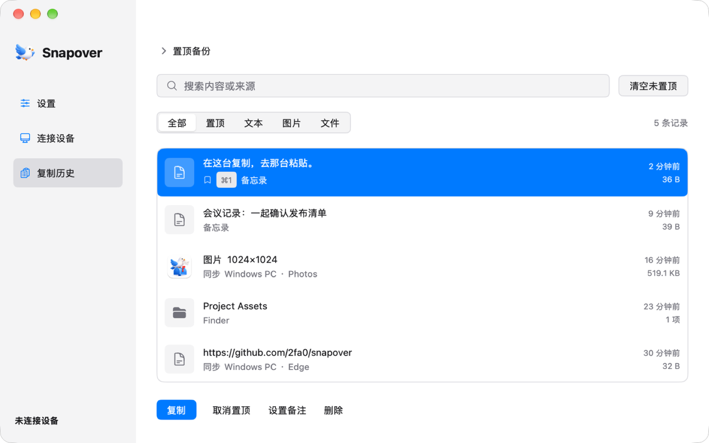

<p align="center">
  
</p>

<h1 align="center">Snapover</h1>

<p align="center">
  <strong>在这台复制，去那台粘贴。</strong><br><br>
  让 Mac 和 Windows 共用一块剪贴板。<br>
  文字、截图、文件、整个文件夹，都能通过加密直连送到另一台电脑。<br>
  不用账号，不经云端，不再给自己发文件。
</p>

<p align="center">
  <a href="https://github.com/2fa0/snapover/releases"><strong>⬇ 下载 Snapover</strong></a> •
  <a href="#-亮点">亮点</a> •
  <a href="#-快速开始">快速开始</a> •
  <a href="#-命令行">命令行</a>
</p>

<p align="center">
  <a href="https://github.com/2fa0/snapover/releases"></a>
  
  
  
</p>

<p align="center">
  <a href="README.md">English</a> | <strong>简体中文</strong>
</p>

<p align="center">
  
</p>

---

<table align="center">
  <tr>
    <td align="center" width="33%">
      <strong>1 · 复制</strong><br><br>
      💻 <strong>A 电脑</strong><br>
      <code>⌘C</code> 或 <code>Ctrl+C</code>
    </td>
    <td align="center" width="33%">
      <strong>2 · 直连</strong><br><br>
      ⚡ <strong>Snapover</strong><br>
      设备之间加密传输
    </td>
    <td align="center" width="33%">
      <strong>3 · 粘贴</strong><br><br>
      🖥️ <strong>B 电脑</strong><br>
      <code>⌘V</code> 或 <code>Ctrl+V</code>
    </td>
  </tr>
</table>

<p align="center">
  <strong>文字 · 图片 · 文件 · 文件夹</strong><br>
  不用上传，不用聊天软件，不用 U 盘。复制，然后粘贴。
</p>

## ✨ 亮点

<table>
  <tr>
    <td width="50%" valign="top">
      <h3>📋 能复制的，不只是文字</h3>
      代码片段、截图、文件或整个文件夹，在 A 电脑复制，到 B 电脑直接粘贴。支持 Finder 和资源管理器多选，保留目录结构，不用压缩，也不用打开发送窗口。
    </td>
    <td width="50%" valign="top">
      <h3>⚡ 找回来，再贴一次</h3>
      macOS 按 <code>⌥⌘V</code>，Windows 按 <code>Alt+V</code>，搜索复制历史，回车直接粘到刚才使用的应用。常用内容可以置顶，前 9 条还能用数字快捷键直接粘贴。
    </td>
  </tr>
  <tr>
    <td width="50%" valign="top">
      <h3>📤 大文件直接送进文件夹</h3>
      通过 Finder「服务」、Windows「发送到」或命令行，把文件保存到对端接收文件夹，不占用剪贴板。支持暂停、继续和断线续传，软件不设文件大小上限。
    </td>
    <td width="50%" valign="top">
      <h3>🔒 私密，是默认设置</h3>
      设备通过 TLS 1.3 直连。首次配对核对六位校验码，并在两台电脑上分别确认；之后按保存的证书指纹验证。没有账号、云端存储和遥测。
    </td>
  </tr>
  <tr>
    <td width="50%" valign="top">
      <h3>🎛️ 同不同步，你说了算</h3>
      自动或手动同步，随时暂停，只同步文字，排除指定应用，或只忽略下一次复制。密码管理器标记过的内容既不进入历史，也不会发送。
    </td>
    <td width="50%" valign="top">
      <h3>🪶 原生应用，也懂终端</h3>
      使用 Go + MyGo 绘制原生控件，不内嵌浏览器。附带的 <code>snapover-cli</code> 可以把文字、图片和文件发送接入脚本与终端工作流。
    </td>
  </tr>
</table>

**还有这些：**自定义快捷键、历史全文搜索、图片预览与缩放、自动更新、中英文界面，以及可选的 Tailscale 跨网络连接。

> [!NOTE]
> 通过剪贴板复制文件／文件夹时，整批默认上限为 20 MB，可在设置中调整；**主动发送文件不受此限制**。完整限制与边界见[功能与行为细节](docs/features_zh.md)。

## 🚀 快速开始

### 1. 在两台电脑上安装 Snapover

从 [**Releases**](https://github.com/2fa0/snapover/releases) 下载最新安装包：

- **macOS 13+**：Apple Silicon 选择 `snapover-<版本>-arm64.dmg`，Intel 选择 `snapover-<版本>-amd64.dmg`，打开后把 Snapover 拖进「应用程序」。
- **Windows 10/11 x64**：解压 `Snapover-<版本>-windows11-x64.zip`，保留同目录文件并运行 `Snapover.exe`。在 exe 旁放一个空的 `portable.flag`，数据就会保存到同目录的 `data/` 文件夹。

<details>
<summary><strong>首次打开须知：Gatekeeper、SmartScreen 与防火墙</strong></summary>

<br>

- **macOS：**目前使用 ad-hoc 签名，尚未公证。右键 `Snapover.app` 选择「打开」，或执行 `xattr -cr /Applications/Snapover.app`。没有 Developer ID 时，安装包只能在打包那台 Mac 上直接打开。系统请求「本地网络」权限时请允许。
- **Windows：**尚未进行代码签名，SmartScreen 可能需要选择「更多信息 → 仍要运行」。防火墙需放行入站 TCP `47821`，自动发现还需要 UDP `5353`；配对前可在「连接设备」页添加防火墙规则。

</details>

### 2. 配对一次

1. 在两台电脑上打开「连接设备 → 添加设备」。
2. 选择另一台电脑；发现不到时手动填写地址，默认端口为 `47821`。
3. 核对两边显示相同的**六位校验码**，然后在**两台电脑上分别确认**。

Snapover 会记住已配对设备并自动重连。双方确认前不会同步任何内容。

### 3. 复制。切到另一台。粘贴。

日常用法就只有这一步。Snapover 常驻菜单栏或系统托盘，关闭窗口不会停止同步。

手动同步、网段选择、多设备与连接排查见[功能与行为细节](docs/features_zh.md)。

## ⌘ 常用快捷键

| 动作 | macOS | Windows |
| --- | --- | --- |
| 打开快速历史 | `⌥⌘V` 或 `Cmd+Shift+V` | `Alt+V` |
| 手动模式下复制并同步 | `⌥⌘C` | `Ctrl+Alt+C` |
| 粘贴前 9 条置顶内容 | `⌘1`–`⌘9` | `Ctrl+1`–`Ctrl+9` |
| 只写入剪贴板，不直接粘贴 | `⌥Enter` | `Alt+Enter` |
| 置顶／取消置顶当前记录 | `⌘⇧P` | `Ctrl+Shift+P` |
| 删除当前记录 | `⌘⇧⌫` | `Ctrl+Shift+Backspace` |

所有快捷键都能在设置中修改。macOS 的快捷粘贴需要在「系统设置 → 隐私与安全性 → 辅助功能」中授权。

## 💻 命令行

附带的 `snapover-cli` 复用桌面应用已经建立的配对和连接，不用重新配置，也不弹发送窗口。把它加入 `PATH`，或设置别名为 `snapover`，然后运行：

```sh
snapover send file './报告.pdf' './截图.png'
snapover send text '你好'
snapover send image './截图.jpg'
cat ./notes.txt | snapover send text --stdin
```

文件进入对端接收文件夹，文字和图片进入对端剪贴板。没有在线设备时会立即报错，不会排队等待。

macOS 与 Windows 的配置方法、PowerShell 示例、完整参数和退出码见[命令行指南](docs/cli_zh.md)。

## 🚧 已知限制

- **远程桌面：**Windows RDP 会话请关闭剪贴板共享，否则 `rdpclip.exe` 可能在 Snapover 接收成功后覆盖内容。
- **图片：**传输使用 PNG；粘贴到部分第三方应用时透明通道可能丢失，详细格式说明见功能文档。
- **不内置：**公网发现／中继和富文本同步。跨网络使用时，请让两台电脑接入 Tailscale，再在 Snapover 中开启支持。

当前行为、完整限制与故障排查见[功能与行为细节](docs/features_zh.md)。

## 🔐 隐私与安全

- 剪贴板数据、配对记录和历史都保存在自己的电脑上：macOS 为 `~/Library/Application Support/Snapover`，Windows 为 `%AppData%\Snapover`。
- 没有遥测，不自动上传日志；日志不记录剪贴板正文、图片字节或私钥。
- 安全漏洞请私下联系作者，不要在公开场合披露细节。

## 📄 许可

Snapover 以 [Apache License 2.0](LICENSE) 授权，版权归作者所有（© 2026 2fa0）。你可以自由使用、修改和分发，包括商业用途，条件是保留版权与许可声明、随分发附带许可证全文，并遵守其中的专利与商标条款。随包分发的第三方组件遵循各自许可证，完整清单见 [THIRD_PARTY_NOTICES.txt](resources/THIRD_PARTY_NOTICES.txt)。
